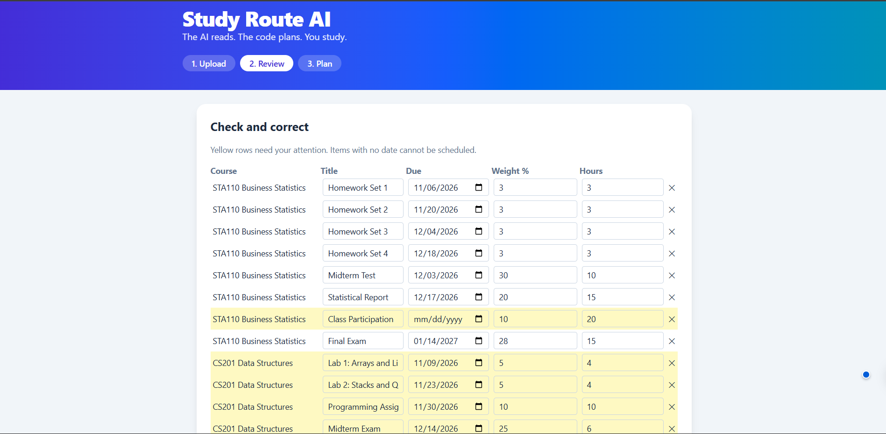
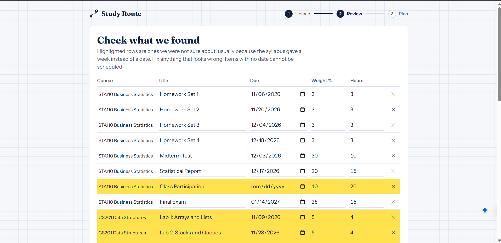
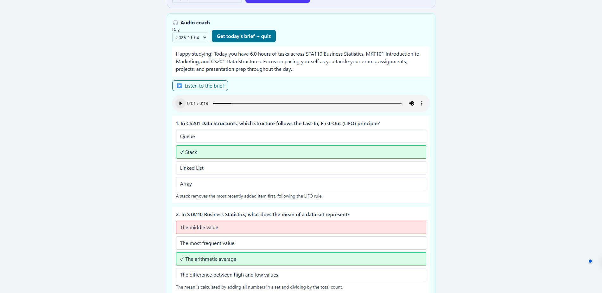
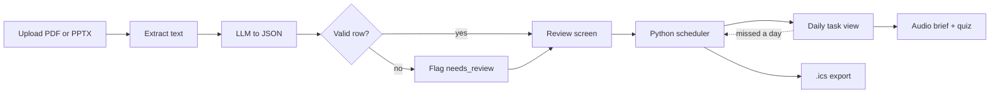

<p align="center">
  
</p>

<p align="center">
  
  
  
  
  
</p>

<p align="center">
  <b>Turn a pile of syllabi into one focused daily study plan, then listen to it.</b>
</p>

<p align="center">
  <a href="https://study-route-ai-ebon.vercel.app/"><b>Live demo</b></a>
</p>

---

## The problem

On day one of term a student gets a syllabus for every course. None share a format, and each has different deadlines, grade weights and reading lists. Merging them by hand into a day-by-day plan is tedious, and calendar apps only store dates. They don't weigh courses against each other or answer **"what should I do tonight with one hour?"**

## The solution

**Study Route AI** reads your syllabi (PDF or slide deck), lets you correct what it found, and builds a prioritised daily schedule of bite-sized tasks. A voice coach then reads out each day's brief and quizzes you on it. Fall behind and one click re-plans the work that is left.

<p align="center">
  
</p>

> **Core design decision:** the LLM only *reads documents* and *writes quiz text*. The schedule is computed by plain Python, so it never invents a due date and every plan can be explained. Anything the AI is unsure about is highlighted for the student to check.

## Screenshots

<!-- Add your screenshots to assets/ and keep these lines -->
| Review and correct | Daily plan | Audio coach |
|---|---|---|
|  |  |  |

## How it works

| # | Module | What it does |
|---|--------|--------------|
| 1 | **Syllabus ingestion** | Extracts text from PDFs and .pptx decks and converts it to schema-validated JSON (course, items, deadlines, grade weights). Bad rows are flagged instead of breaking the sheet. Relative dates like "Week 7" are resolved from the student's term start date and highlighted yellow for review. Results are cached per document, and the app falls back to alternative models if one is busy. |
| 2 | **Schedule engine** | A pure Python function of tasks, daily hours and start date. It ranks work by deadline, grade weight and effort, fills each day's available time, and reports work that cannot fit before its deadline as **at risk**. |
| 3 | **Re-planner** | "I missed a day": ticked tasks are subtracted and the same scheduler runs again from a new date. |
| 4 | **Audio coach** | Generates a short daily briefing and 3-question quiz, spoken with smallest.ai text-to-speech. Audio is cached, and everything also works as plain text. |
| 5 | **Calendar export** | Downloads the plan as an `.ics` file of all-day events for Google, Apple or Outlook calendar. |



## Features

- [x] Upload multiple syllabus PDFs or .pptx slide decks (drag and drop)
- [x] Editable review table with flagged rows
- [x] Deterministic, weighted schedule with "at risk" warnings
- [x] Daily task view with progress tracking
- [x] Spoken briefing and tap-to-answer quiz (smallest.ai)
- [x] "I missed a day" re-plan
- [x] `.ics` calendar export
- [x] Deployed online (Vercel + Render)
- [ ] Stretch: spoken quiz answers
- [ ] Stretch: OCR for scanned PDFs

## Results

All numbers below were measured by running the app. Anything not yet measured is marked as such.

| Metric | How | Result |
|--------|-----|--------|
| Extraction accuracy (synthetic) | 3 test syllabi we wrote (table, "Week N" and prose formats), every date and weight checked against an answer key with `evaluate.py` | **42 / 42 fields (100%)** |
| Extraction accuracy (real syllabi) | Real syllabi, checked by hand | Not tested yet |
| Extraction speed | One uncached 1-page syllabus (`MKT101`), measured by `evaluate.py` | 20.9 s (cached documents return in about 1 s) |
| Time to plan vs. by hand | Upload to finished plan in the app, vs. building the same plan manually | Not measured yet |
| Student feedback | 5 students tried the prototype | See below |

The synthetic syllabi are cleaner than real ones, so real results will be reported separately.

### Student feedback (5 students)

- **Was it clear what to do?** Yes
- **Would you use it?** Yes
- **Most common confusion:** the waiting time while the AI reads the files
- **Liked most:** the simplicity, the voice briefing, the quiz and the calendar export

This is a small informal sample from classmates, so treat it as early feedback, not proof. The main fix it points to is better progress feedback during extraction.

## Tech stack

| Layer | Tools |
|-------|-------|
| Frontend | React, Vite, Tailwind CSS (Vercel) |
| Backend | Python, FastAPI, Pydantic, pypdf, python-pptx (Render) |
| AI | Gemini API for extraction and quiz generation |
| Voice | smallest.ai text-to-speech |
| Export | `icalendar` (`.ics`) |

## Run it locally

**Prerequisites:** Git, Python 3.11+, Node 18+

```bash
git clone https://github.com/astrax-gif/study-route-ai.git
cd study-route-ai
```

**Backend**

```bash
cd backend
python -m venv venv
venv\Scripts\activate          # macOS/Linux: source venv/bin/activate
pip install -r requirements.txt
```

Create `backend/.env` (never commit it):

```
LLM_PROVIDER=gemini
LLM_API_KEY=your-key
LLM_MODEL=a-gemini-flash-model
LLM_FALLBACK_MODELS=another-model
SMALLEST_API_KEY=your-key
```

```bash
uvicorn app.main:app --reload
```

**Frontend** (new terminal)

```bash
cd frontend
npm install
npm run dev
```

Open http://localhost:5173

**Tests and accuracy check** (from `backend`)

```bash
python -m pytest        # scheduler unit tests
python evaluate.py      # extraction accuracy on the sample syllabi
```

## Deployment

- **Backend (Render):** root `backend`, build `pip install -r requirements.txt`, start `uvicorn app.main:app --host 0.0.0.0 --port $PORT`. Environment variables: the `.env` values above plus `ALLOWED_ORIGINS` set to the frontend URL.
- **Frontend (Vercel):** root `frontend`, environment variable `VITE_API_URL` set to the backend URL.

The free backend sleeps when idle, so the first request after a pause can take up to a minute.

## Project structure

```
study-route-ai/
├── assets/              # README visuals
├── backend/
│   ├── app/
│   │   ├── main.py      # FastAPI routes
│   │   ├── schemas.py   # data contract
│   │   ├── extract.py   # PDF/PPTX -> validated JSON, cache, fallbacks
│   │   ├── scheduler.py # deterministic planner
│   │   ├── quiz.py      # briefing and quiz generation
│   │   ├── tts.py       # smallest.ai + audio cache
│   │   └── ics.py       # calendar export
│   ├── tests/           # scheduler tests
│   ├── sample_syllabi/  # synthetic test syllabi
│   └── evaluate.py      # accuracy check
└── frontend/            # React app
```

## Known limits

- Works with PDFs and slide decks that contain selectable text. Scanned documents are not supported yet.
- The AI can make mistakes, which is why every extraction passes through the review screen.
- The quiz is built from task names, so it tests general topic knowledge, not the exact lecture content.
- Reading a new document takes from about 20 seconds up to a minute, and the free backend can take extra time to wake up after being idle.
- The hosted demo depends on third-party AI services, which can be briefly busy.

## Privacy

Uploaded documents are used only to build the student's plan and are not used for training. Course text is sent to the AI and text-to-speech providers to generate results, and users are told this before uploading.

## Author

Built for Hack Global by **Abdurhman Abebe**.

---

<p align="center"><i>The AI reads. The code plans. You study.</i></p>
