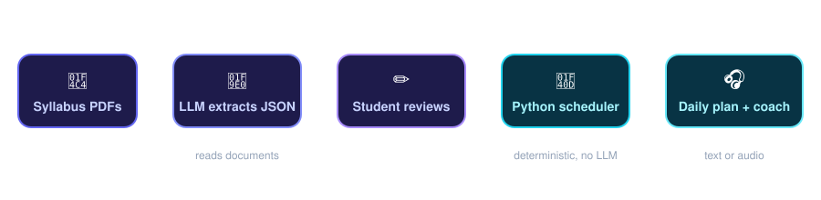
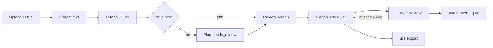

<p align="center">
  
</p>

<p align="center">
  
  
  
  
  
</p>

<p align="center">
  <b>Turn a pile of syllabi into one focused daily study plan, then listen to it.</b>
</p>

---

## The problem

On day one of term a student gets a syllabus for every course. None share a format, and each has different deadlines, grade weights and reading lists. Merging them by hand into a day-by-day plan is tedious, and calendar apps only store dates. They don't weigh courses against each other or answer **"what should I do tonight with one hour?"**

## The solution

**Study Route AI** reads your syllabi, lets you correct what it found, and builds a prioritised daily schedule of bite-sized tasks. A voice coach then reads out each day's brief and quizzes you on it.

<p align="center">
  
</p>

> **Core design decision:** the LLM only *reads documents* and *writes quiz text*. The schedule is computed by plain Python, so there are no hallucinated due dates and every plan can be explained.

## How it works

| # | Module | What it does |
|---|--------|--------------|
| 1 | **Syllabus ingestion** | Extracts PDF text, converts it to schema-validated JSON (course, items, deadlines, grade weights, readings). Bad rows are flagged for review instead of breaking the whole sheet. Relative dates like "Week 7" are resolved from the student's term start date. |
| 2 | **Schedule engine** | A pure Python function of tasks, daily hours and start date. It ranks work by deadline, grade weight and effort, then fills each day's available time. Missed a day? The same function re-plans the unfinished work. |
| 3 | **Audio coach** | Generates a short daily briefing and quiz, spoken with smallest.ai text-to-speech. Audio is cached, and everything also works in silent text mode. |



## Features

- [ ] Upload multiple syllabus PDFs
- [ ] Editable review table with flagged rows
- [ ] Deterministic, weighted schedule with "at risk" warnings
- [ ] Daily task view
- [ ] Spoken briefing and tap-to-answer quiz (smallest.ai)
- [ ] "I missed a day" re-plan
- [ ] `.ics` calendar export
- [ ] Stretch: spoken replies, OCR for scanned PDFs, slide decks as input

*(Tick these off as you build them.)*

## Tech stack

| Layer | Tools |
|-------|-------|
| Frontend | React, Vite, Tailwind CSS |
| Backend | Python, FastAPI, Pydantic, pypdf |
| AI | LLM API for extraction and quiz generation |
| Voice | smallest.ai text-to-speech |
| Export | `icalendar` (`.ics`) |

## Getting started

**Prerequisites:** Git, Python 3.11+, Node 18+

```bash
git clone https://github.com/<your-username>/study-route-ai.git
cd study-route-ai
```

**Backend**

```bash
cd backend
python -m venv venv
venv\Scripts\activate          # macOS/Linux: source venv/bin/activate
pip install -r requirements.txt
copy .env.example .env         # macOS/Linux: cp .env.example .env
uvicorn app.main:app --reload
```

API docs open at http://localhost:8000/docs

**Frontend** (new terminal)

```bash
cd frontend
npm install
npm run dev
```

App opens at http://localhost:5173

**Environment variables** (`backend/.env`)

```
LLM_API_KEY=
SMALLEST_API_KEY=
```

## Project structure

```
study-route-ai/
├── assets/              # README visuals
├── backend/
│   ├── app/
│   │   ├── main.py      # FastAPI routes
│   │   ├── schemas.py   # data contract
│   │   ├── extract.py   # PDF -> validated JSON
│   │   ├── scheduler.py # deterministic planner
│   │   ├── quiz.py      # quiz generation
│   │   ├── tts.py       # smallest.ai + audio cache
│   │   └── ics.py       # calendar export
│   ├── tests/
│   └── sample_syllabi/
└── frontend/            # React app
```

## How we measure success

We will fill these in with real measured values, whatever they turn out to be.

| Metric | How | Result |
|--------|-----|--------|
| Extraction accuracy | % of deadlines and weights correct across 5+ real syllabi vs. a manual check | _TBD_ |
| Time to plan | Upload to finished schedule, vs. building one by hand | _TBD_ |
| Student feedback | 5+ students try the prototype | _TBD_ |

## Privacy

Uploaded documents are used only to build that student's plan. We don't train on or share them, and users can delete their files and extracted data at any time. Course content is sent to the LLM and text-to-speech vendors to generate outputs, and users are told this before uploading.

## Team

| Name | University | Focus |
|------|------------|-------|
| **Abdurhman Bereket** | University of Europe for Applied Sciences, Dubai | Backend, extraction, scheduler, quiz generation |
| **Daniel Chideraaodesigo Unegbu** | University of Europe for Applied Sciences, Dubai | Frontend, review screen, daily view, voice integration |

## License

MIT (add a `LICENSE` file to the repo).

---

<p align="center"><i>Built for hackglobal The AI reads. The code plans. You study.</i></p>
